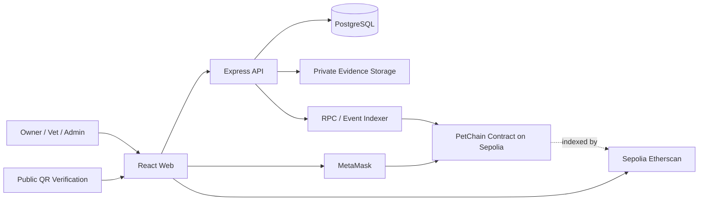

# PetChain — Blockchain Pet Identity & Ownership Registry

## 1. ที่มาและปัญหา
สัตว์เลี้ยงอาจมีรูปลักษณ์เหมือนกัน เอกสารสูญหาย ถูกขโมย หรือมีผู้แอบอ้างสิทธิ์ ระบบจึงต้องแยกการระบุตัวสัตว์ การตรวจหลักฐานเจ้าของ และการรับรองทะเบียนออกจากกัน Blockchain ใช้ตรวจสอบประวัติและผู้ลงนาม ไม่สามารถพิสูจน์ข้อเท็จจริงภายนอกได้เอง

## 2. วัตถุประสงค์
- สร้างทะเบียนและบัตรดิจิทัลที่ตรวจสอบสถานะได้
- ป้องกันการรับรองหมายเลขไมโครชิปซ้ำในระบบ
- บันทึกผู้รับรองและประวัติการเปลี่ยนทะเบียน
- รองรับสัตว์หาย การโอนทะเบียน ข้อพิพาท และการเพิกถอน

## 3. ขอบเขตและสมมติฐาน
ต้นแบบนักศึกษา ใช้ข้อมูลจำลองและ Sepolia Testnet ไม่มีเงินจริง ไม่มีการเชื่อมหน่วยงานราชการหรือคลินิกจริง บัตรเป็นบัตรของ PetChain ไม่ใช่เอกสารกรรมสิทธิ์ตามกฎหมาย กำหนดให้สัตว์ไม่มีชิปมีได้เพียงทะเบียนชั่วคราว ไม่ออกบัตรรับรองเต็มรูปแบบจนกว่าจะตรวจชิปและหลักฐานเจ้าของ

## 4. ผู้ใช้งานและสิทธิ์
| Role | สิทธิ์ |
|---|---|
| Public | ตรวจบัตรและสถานะผ่าน QR โดยไม่ต้องมี Wallet |
| Owner | ยื่นคำขอ ส่งหลักฐาน แจ้งหาย ขอและรับโอน ยื่นข้อพิพาท |
| Veterinarian | ตรวจตัวสัตว์ อ่านชิป รับรองผลตรวจ |
| Admin / Reviewer | ตรวจหลักฐานเจ้าของ รับเรื่องข้อพิพาท ระงับทะเบียน จัดการสิทธิ์ผู้รับรอง |
| Review Committee | Wallet ผู้พิจารณา 3 บัญชี อนุมัติ 2 ใน 3 สำหรับแก้ไขเจ้าของกรณีพิเศษและเพิกถอนการรับรองสำคัญ |

ผู้รับรองต้องได้รับการตรวจตัวตนก่อนอนุมัติ Wallet; ต้นแบบใช้บัญชีจำลอง ผู้ดูแลไม่ควรสามารถแต่งตั้งผู้พิจารณาใหม่เพียงลำพังแล้วใช้สิทธิ์เปลี่ยนทะเบียนได้ การเปลี่ยนคณะผู้พิจารณาต้องผ่านเกณฑ์ 2 ใน 3 เช่นกัน

## 5. ข้อมูลสัตว์และหลักฐาน
- Pet ID, ชื่อ, ประเภท, สายพันธุ์, เพศ, วันเกิดโดยประมาณ, สี, ตำหนิ, รูปภาพ
- Microchip ID (เก็บนอก Chain), ผลอ่านชิป, วันที่ตรวจ, ผู้ตรวจ
- ผู้ยื่นคำขอ, ผู้ถือทะเบียน, หลักฐานรับเลี้ยง/ซื้อขาย, ประวัติรักษา, หลักฐานฝังชิป
- ผู้ดูแลชั่วคราว (ข้อมูลเสริม ไม่ใช่เจ้าของ), สถานะสัตว์หาย
- เลขบัตร, รุ่นบัตร, วันที่ออก, สถานะการรับรอง

ไม่เผยแพร่ชื่อจริง ที่อยู่ เอกสาร รูปส่วนตัว หรือเลขชิปบน Chain ใช้รหัสอ้างอิงแบบสุ่มและ digest ของชุดหลักฐานที่จัดรูปแบบแน่นอนพร้อม nonce สุ่ม เก็บ nonce และหลักฐานในระบบที่ควบคุมสิทธิ์ การตรวจชิปซ้ำใช้ฐานข้อมูลที่จำกัดสิทธิ์และ unique constraint สำหรับชิปที่รับรองแล้ว รวมถึงรหัสชิปแบบ HMAC ที่สร้างโดย Backend ด้วยกุญแจลับคงที่เพื่อให้ Contract ตรวจ token ซ้ำได้ ผู้รับรองตรวจความถูกต้องของ token ผ่านกระบวนการที่เชื่อถือได้ ทั้งนี้ Contract ไม่สามารถตรวจความสัมพันธ์ระหว่าง token กับชิปจริงได้เอง การเปลี่ยนกุญแจต้องมีแผน migration ป้องกันทะเบียนซ้ำ

## 6. สถานะระบบ
| มิติ | สถานะ |
|---|---|
| Identity | Unverified, Verified, Uncertain |
| Ownership | Pending, Verified, Disputed, Rejected |
| Registration | Pending, Active, Suspended, Revoked, Deceased |
| Lost | Normal, Missing |
| Transfer | Pending, Accepted, Cancelled, Expired |
| Dispute | Submitted, UnderReview, Resolved, Unresolved, Rejected |

ออกบัตรเต็มรูปแบบได้เมื่อ Identity และ Ownership เป็น Verified และ Registration เป็น Active เท่านั้น ห้ามโอนเมื่อ Missing, Suspended, Disputed, Revoked หรือ Deceased การรับเรื่องข้อพิพาทต้องผ่านผู้ตรวจสอบเบื้องต้นเพื่อป้องกันการกลั่นแกล้งระงับทะเบียนด้วยคำร้องเปล่า

## 7. Workflow
### 7.1 ลงทะเบียนและออกบัตร
Owner เชื่อม Wallet และยืนยันตัวตน → ส่งข้อมูลและหลักฐาน → Pending → สัตวแพทย์ตรวจสัตว์จริงและอ่านชิป → ตรวจชิปซ้ำ → Reviewer ตรวจหลักฐานเจ้าของ → Smart Contract บันทึกผลรับรอง → Active → สร้างบัตรและ QR

### 7.2 ตรวจบัตร
สแกน QR → เปิด URL ของระบบพร้อม Pet ID และรุ่นบัตร → อ่านสถานะจาก Contract → แสดง Valid / Suspended / Revoked / Superseded ตามผลจริง QR ที่คัดลอกได้ไม่ใช่หลักฐานว่าตัวสัตว์ตรงกับทะเบียน ต้องอ่านชิปจริงเมื่อจำเป็น

### 7.3 โอนทะเบียน
เจ้าของเดิมสร้างคำขอระบุ Wallet ผู้รับและวันหมดอายุ → ผู้รับตรวจข้อมูลและยืนยัน → Contract ตรวจสิทธิ์และสถานะอีกครั้ง → เปลี่ยนผู้ถือทะเบียน → เพิ่มรุ่นบัตร → บันทึก Event ไม่ถือว่าเป็นการส่งมอบสัตว์จริงหรือกรรมสิทธิ์ตามกฎหมาย

### 7.4 ข้อพิพาท
ผู้ร้องส่งหลักฐาน → Reviewer คัดกรอง → ระงับทะเบียนหากมีเหตุสมควร → เปิดให้คู่กรณีส่งหลักฐาน → ผู้พิจารณาอนุมัติผลเดียวกัน 2 ใน 3 → แก้ไขทะเบียน/ยกคำร้อง/คงสถานะ Unresolved → บันทึกเหตุผลอ้างอิงและ Event หากหลักฐานไม่พอ ห้ามเดาเจ้าของ

### 7.5 สัตว์หายและพบสัตว์
เจ้าของแจ้งหาย → ระงับการโอน → ผู้พบส่งข้อมูลแบบส่วนตัว → สัตวแพทย์ตรวจชิป → ติดต่อผ่านระบบ → เจ้าของหรือผู้พิจารณาตามกรณียืนยันการคืนสัตว์ → ปลดสถานะ Missing โดยไม่ปลดข้อพิพาทอื่นอัตโนมัติ

## 8. Architecture และ Tech Stack
- Frontend: React + Vite + Tailwind CSS + ethers.js + MetaMask
- Backend: Node.js + Express + Prisma
- Database: PostgreSQL
- Private file storage: local protected storage สำหรับต้นแบบ
- Smart Contract: Solidity + OpenZeppelin AccessControl + Remix IDE
- Network: Remix VM สำหรับทดสอบ, Ethereum Sepolia (11155111) สำหรับสาธิตจริง
- Explorer: Sepolia Etherscan สำหรับตรวจธุรกรรมและยืนยัน source code


Backend ใช้ nonce แบบครั้งเดียวและข้อความลงนามที่ผูก domain, chain ID, วันหมดอายุ เพื่อสร้าง session ตรวจสิทธิ์ทั้ง API และ Contract ไม่เชื่อ role ที่ส่งจาก frontend ไม่เก็บ private key ผู้ใช้ Backend sync event แบบ idempotent โดยใช้ chain ID + tx hash + log index และรองรับ reorg; สถานะบน Chain เป็นแหล่งอ้างอิงทะเบียน ส่วนหลักฐานต้นฉบับอยู่ off-chain

## 9. Smart Contract specification
| Function | Caller / เงื่อนไข |
|---|---|
| registerPet(profileDigest) | Owner; สร้าง Pending ไม่จองชิปแบบถาวร |
| verifyAnimal(petId, chipToken, evidenceDigest) | Vet ที่มีสิทธิ์; token ไม่ถูกผูกกับทะเบียนอื่น |
| verifyOwnership(petId, evidenceDigest) | Reviewer; ตรวจหลักฐานและไม่มีข้อพิพาท |
| issueCard(petId) | Reviewer; ผ่านทั้งสองการรับรอง |
| requestTransfer(petId, recipient, expiry) | ผู้ถือทะเบียน; สถานะอนุญาต |
| acceptTransfer(petId) | ผู้รับที่กำหนด; ตรวจ expiry และสถานะซ้ำ |
| cancelTransfer(petId) | ผู้ส่งคำขอ |
| reportMissing(petId) | ผู้ถือทะเบียน |
| reportFound(petId) | ผู้ถือทะเบียนหรือผู้ตรวจสอบที่มีสิทธิ์ตามหลักฐาน |
| openDispute(petId, evidenceDigest) | ผู้ร้อง; ไม่ freeze ทันที |
| reviewDispute(disputeId) | Reviewer; รับเรื่องและ freeze |
| proposeResolution / approveResolution | Committee; 2 ใน 3 คนต่างกัน ผลเดียวกัน ไม่ replay |
| getPet / getCardStatus | Public |
| proposeGovernanceChange / approveGovernanceChange | Committee; เปลี่ยนสิทธิ์สำคัญ 2 ใน 3 |

Events: PetRegistered, AnimalVerified, OwnershipVerified, CardIssued, TransferRequested, TransferAccepted, MissingReported, DisputeOpened, RegistrationSuspended, DisputeResolved, VerificationRevoked, RoleChanged

Invariant: ชิปที่รับรองแล้วผูกกับทะเบียนเดียว; ไม่ออกบัตรโดยไม่มีการรับรองทั้งสองส่วน; ห้ามโอนเมื่อมีเหตุระงับ; เปลี่ยนข้อมูลสำคัญต้องเพิกถอนผลรับรองที่เกี่ยวข้องและตรวจใหม่; คำขอโอนเดิมถูกยกเลิกเมื่อระงับหรือเปลี่ยนเจ้าของ; การอนุมัติกรณีพิเศษผูกกับ proposal ID, action, parameters, version และ expiry

## 10. Database design
| Table | Fields หลัก |
|---|---|
| users | id, wallet_address, role, status |
| pets | id, onchain_id, profile, owner_id, profile_version |
| microchips | id, pet_id, encrypted_chip, chip_token, status |
| evidence | id, pet_id, uploader_id, storage_key, digest, type |
| verifications | id, pet_id, verifier_id, type, decision, tx_hash |
| disputes | id, pet_id, claimant_id, status, evidence_id |
| dispute_votes | dispute_id, reviewer_id, proposal_id, decision |
| transfers | id, pet_id, from_wallet, to_wallet, expiry, status |
| cards | pet_id, version, issued_at, tx_hash |
| chain_events | chain_id, tx_hash, log_index, block_hash, event_type |

## 11. API endpoints
- POST /auth/nonce, POST /auth/verify
- POST /pets, GET /pets/me, GET /pets/:id
- POST /pets/:id/evidence, GET /evidence/:id (authorized only)
- GET /vet/requests, POST /vet/requests/:id/review
- GET /admin/requests, POST /admin/requests/:id/review
- POST /disputes, GET /disputes/:id, POST /disputes/:id/evidence
- GET /public/cards/:petId/:version (ข้อมูลสาธารณะขั้นต่ำ)
- GET /transactions/:hash

API เตรียมข้อมูลและหลักฐาน; การเปลี่ยนสถานะบน Chain ต้องลงนามผ่าน Wallet ที่มีสิทธิ์ ไม่ถือว่า API success คือ transaction success

## 12. หน้าจอ
Public: Home, Verify Card
Owner: Dashboard, Register Pet, My Pets, Pet Details, Digital Card, Transfer, Lost & Found, Dispute
Vet: Verification Queue, Animal Inspection, Verification History
Admin: Owner Review, Dispute Queue, Resolution Voting, Role Management, Audit Log

## 13. Edge cases และ Acceptance Criteria
| กรณี | ผลที่คาดหวัง |
|---|---|
| สัตว์เหมือนกันทุกอย่าง | แยกด้วยชิปที่อ่านจริง ไม่ใช้ชื่อหรือรูปเป็น unique key |
| ไม่มีชิป | Pending/Uncertain ไม่ออกบัตรเต็มรูปแบบ |
| ชิปซ้ำหรือคัดลอก | ปฏิเสธการรับรองซ้ำ เปิดตรวจสอบ ไม่สรุปว่าใครโกง |
| สัตว์มีสองชิป | ตรวจประวัติและผูก alias กับทะเบียนเดียวผ่านการตรวจพิเศษ (ออกแบบอนาคต) |
| ชิปเสียหรือเปลี่ยน | ระงับและตรวจใหม่ เก็บประวัติ token เดิม (อนาคต) |
| ขโมยสัตว์ไปลงทะเบียนก่อน | ตรวจหลักฐาน ไม่ใช้ลำดับการสมัครตัดสินเจ้าของ |
| ขโมยสัตว์แล้วฝังชิปใหม่ | เปิดข้อพิพาท; ไม่มีหลักฐานพอให้ Unresolved |
| เอกสารปลอม | ตรวจต้นทางโดยคน; hash ไม่พิสูจน์ความแท้ |
| ผู้ตรวจสอบรับรองผิด | เพิกถอนผลเดิมด้วยกระบวนการอนุมัติและตรวจใหม่ |
| Admin โกง | การแก้เจ้าของพิเศษต้อง 2 ใน 3; ยังเสี่ยงสมรู้ร่วมคิด |
| ผู้ตรวจสอบถูกแฮ็ก | เพิกถอนสิทธิ์ ตรวจผลรับรองช่วงเสี่ยง |
| Wallet เจ้าของสูญหาย/ถูกขโมย | ระงับและใช้ข้อพิพาทแก้ทะเบียนหลังตรวจหลักฐาน |
| เจ้าของเสียชีวิต | กระบวนการข้อพิพาท/เปลี่ยนทะเบียนพิเศษตามหลักฐาน |
| ขายสัตว์แต่ไม่โอน | ผู้ซื้อยื่นข้อพิพาท |
| โอนผิด Wallet | ผู้รับต้องยืนยัน; หากสำเร็จแล้วใช้กระบวนการข้อพิพาท |
| ผู้รับไม่ตอบ | หมดอายุหรือยกเลิกคำขอ |
| เจ้าของร่วม/ผู้เยาว์ | ใช้ผู้จัดการทะเบียนหนึ่งบัญชีใน MVP; รองรับหลายผู้ถือสิทธิ์ในอนาคต |
| ผู้รับฝากเลี้ยงอ้างเป็นเจ้าของ | ตรวจหลักฐาน ไม่ใช้การครอบครองอย่างเดียว |
| สัตว์หายระหว่างรอโอน | ยกเลิกคำขอโอนและห้ามโอนใหม่ |
| สัตว์ตาย | เปลี่ยน Deceased หลังตรวจหลักฐานผ่านกระบวนการพิเศษ |
| QR ถูกคัดลอก | แสดงสถานะล่าสุดและรุ่นบัตร ไม่ยืนยันตัวสัตว์จาก QR |
| กดธุรกรรมซ้ำ | Contract ตรวจสถานะและไม่สร้างผลซ้ำ |
| ส่งธุรกรรมตรงข้ามหน้าเว็บ | Contract ปฏิเสธผู้ไม่มีสิทธิ์ |
| ไม่มี Gas / Network ผิด | แจ้งข้อผิดพลาด ไม่แสดงว่าสำเร็จ |
| RPC ล่ม / reorg | แสดง pending/unavailable และ sync ใหม่ |
| เอกสารถูกแก้ | ตรวจ digest ไม่ตรงและแจ้งเตือน |
| ขอลบข้อมูลส่วนตัว | จัดการ off-chain ตามนโยบาย; ไม่อ้างว่าลบธุรกรรมเดิมได้ |
| ผู้ร้องกลั่นแกล้ง | คัดกรองก่อนระงับ จำกัด spam นอก Chain |
| ผู้พิจารณาโหวตซ้ำ | ปฏิเสธ; นับเฉพาะคนต่างกันและ proposal เดียวกัน |

## 14. MVP และงานอนาคต
MVP: ลงทะเบียน, ตรวจชิปซ้ำ, รับรองสองส่วน, บัตร QR, โอนสองฝ่าย, แจ้งหาย, ข้อพิพาท, การตัดสิน 2 ใน 3, ประวัติ Event, ทดสอบสิทธิ์
อนาคต: เชื่อมคลินิกและทะเบียนจริง, การเปลี่ยนชิป/หลายชิปเต็มรูปแบบ, เจ้าของร่วม, กู้คืนกุญแจระดับองค์กร, ตรวจสอบเอกสารอัตโนมัติ

## 15. Definition of Done
- สาธิตบน local chain และ Sepolia พร้อม Contract Address, verified source และ transaction hashes บน Etherscan; หากขาด Test ETH หรือ RPC ให้ระบุว่ายังไม่ผ่านเกณฑ์
- มีบัญชีจำลอง Owner A/B, Vet, Reviewer และ Committee 3 บัญชี
- ทดสอบเส้นทางปกติและกรณีผิดสิทธิ์ตามขอบเขต MVP
- ไม่เผยหลักฐานส่วนตัวใน API สาธารณะหรือ Chain
- มี README, วิธี deploy, contract address ตาม network, test report และข้อจำกัด

## 16. ข้อจำกัดที่ต้องตอบอาจารย์
ระบบไม่รับประกันความจริงของหลักฐาน ไม่สามารถตัดสินกรรมสิทธิ์ตามกฎหมาย ไม่ป้องกันการสมรู้ร่วมคิดทั้งหมด ไม่รับประกันความเป็นเอกลักษณ์ของสัตว์ไม่มีชิปหรือชิปที่ถูกสวม และยังต้องเชื่อถือกระบวนการตรวจนอก Chain หากฐานข้อมูลทั่วไปพร้อม audit log เพียงพอต่อความต้องการ Blockchain อาจไม่จำเป็น จุดประสงค์ของต้นแบบคือให้หลายบทบาทลงนามและตรวจประวัติการรับรองร่วมกันได้


## 17. Sepolia, MetaMask และ Etherscan Integration

### 17.1 Network configuration
- Network: Ethereum Sepolia; chain ID 11155111 (0xaa36a7); currency ETH สำหรับทดสอบ
- Explorer: https://sepolia.etherscan.io/
- Wallet: https://metamask.io/ เปิด Show test networks แล้วเลือก Sepolia
- RPC: ใช้ HTTPS endpoint จากผู้ให้บริการที่ทีมเลือก; ไม่ใช้ Mainnet หรือเงินจริง
- เตรียม Test ETH จาก faucet ที่รองรับ Sepolia ให้ทุกบัญชีที่ต้องส่งธุรกรรม โดยไม่เปิดเผย seed phrase

### 17.2 Environment และ deployment
ใช้ Remix IDE (https://remix.ethereum.org/) เป็นเครื่องมือหลักสำหรับเขียน Compile, Test และ Deploy Solidity โดยใช้ OpenZeppelin 5.x รุ่นที่ล็อกไว้และ Solidity compiler ที่เข้ากันได้ ไม่จำเป็นต้องติดตั้ง Hardhat

ตัวแปรฝั่ง server: `SEPOLIA_RPC_URL`, `CHAIN_ID=11155111`, `CONTRACT_ADDRESS` และ `DEPLOYMENT_BLOCK` หลัง deploy จริง
ตัวแปรฝั่ง web: `VITE_CHAIN_ID=11155111`, `VITE_CONTRACT_ADDRESS`, `VITE_EXPLORER_URL=https://sepolia.etherscan.io` และ public RPC ที่อนุญาตให้เปิดเผยได้ ห้ามใส่ private key หรือ secret API key ใน VITE variables หรือ Git

ขั้นตอน:
1. เปิด Remix IDE นำเข้า Solidity source และ dependencies ที่ระบุรุ่นแน่นอน เลือก compiler, optimizer และ EVM version แล้วบันทึก settings
2. Compile และทดสอบบน Remix VM ด้วยหลายบัญชี รวมทั้งกรณี revert; ใช้ Solidity Unit Testing plugin หรือชุดทดสอบที่ทำซ้ำได้
3. เปิด MetaMask เลือก Sepolia และเตรียม Test ETH; ใน Deploy & Run Transactions เลือก Injected Provider / Browser Extension ที่เชื่อม MetaMask ตรวจ chain ID 11155111 และบัญชี deployer ก่อน deploy พร้อม constructor arguments จริง
4. ยืนยันธุรกรรมใน MetaMask แล้วบันทึก contract address, ABI จาก Compilation Details, deployment transaction hash, block และ compiler settings ลง deployment manifest
5. Verify source ผ่าน Contract Verification plugin ของ Remix หากรองรับ Sepolia/Etherscan หรือผ่านหน้า Verify and Publish ของ Sepolia Etherscan โดยใช้ Standard JSON Input และ compiler/settings/constructor arguments ตรงกับที่ deploy จริง; หากต้องใช้ API key ให้เก็บเป็นความลับ
6. ตรวจสถานะ source verified และ bytecode บน Etherscan แล้วส่ง ABI และ manifest ให้ทีม ตั้งสิทธิ์ Vet, Reviewer และ Committee ผ่านธุรกรรมจริงตาม governance

### 17.3 MetaMask / ethers v6
ใช้ BrowserProvider สำหรับ wallet และ JsonRpcProvider สำหรับ public read-only. ตรวจ chain ก่อน sign/send ทุกครั้ง; รองรับ account/network change, disconnect, user rejection และ insufficient gas. ตัวอย่างแนวทาง (ต้องนำไปประกอบกับ ABI และ UI จริง):

```js
import { BrowserProvider, Contract } from 'ethers';
export async function connect(address, abi) {
  if (!window.ethereum) throw new Error('MetaMask not available');
  await window.ethereum.request({ method: 'eth_requestAccounts' });
  await window.ethereum.request({ method: 'wallet_switchEthereumChain', params: [{ chainId: '0xaa36a7' }] });
  const provider = new BrowserProvider(window.ethereum);
  if ((await provider.getNetwork()).chainId !== 11155111n) throw new Error('Wrong network');
  return new Contract(address, abi, await provider.getSigner());
}
```
หาก wallet ไม่มี Sepolia ให้แนะนำเปิด test networks หรือเพิ่มเครือข่ายด้วย RPC ที่เชื่อถือได้; จัดการ error 4001/4902 และล้าง session/cache เมื่อบัญชีหรือ chain เปลี่ยน. Backend ตรวจลายเซ็น nonce และ chain ID แยกจากการเชื่อม wallet.

### 17.4 Etherscan verification UI
- Contract: `https://sepolia.etherscan.io/address/{contractAddress}#code`
- Transaction: `https://sepolia.etherscan.io/tx/{txHash}`
- Wallet: `https://sepolia.etherscan.io/address/{walletAddress}`
- แสดงปุ่ม View on Etherscan สำหรับ registration, verification, card issuance, transfer, missing, dispute และ governance transactions
- แสดง tx hash, block number, sender, event, status และเวลาเมื่อมี receipt; ตรวจ receipt.status และ event ที่คาดหวังจาก contract address จริง
- ใช้สถานะ Awaiting signature / Submitted / Confirming / Confirmed / Failed / Rejected / Replaced; กำหนด 2 confirmations เป็นเกณฑ์ UI เบื้องต้น ไม่ใช่ finality และรองรับ reorg
- Etherscan เป็น explorer/indexer อาจแสดงช้ากว่า RPC; ไม่ใช้เป็นแหล่งตัดสินสิทธิ์หรือยืนยันความจริงของข้อมูลสัตว์ ไม่ต้องใช้ API key สำหรับลิงก์ทั่วไป
- Public QR อ่านสถานะล่าสุดจาก RPC โดยไม่ต้องมี MetaMask; Etherscan เป็นหลักฐานเสริม ไม่ใช่ QR ที่ยืนยันตัวสัตว์จริง

### 17.5 Acceptance tests บน Sepolia
- Owner A ลงทะเบียน; Vet รับรอง; Reviewer รับรองเจ้าของและออกบัตร; เปิด tx แต่ละรายการบน Etherscan ตรวจ sender และ event
- Owner B พยายามแก้ไขโดยไม่มีสิทธิ์: contract ต้องปฏิเสธ; หาก wallet ปฏิเสธหรือ simulation ล้มเหลวก่อนส่ง จะไม่มี tx hash
- โอน A ไป B โดยสองฝ่ายลงนาม; ตรวจ owner ใหม่และประวัติบน explorer
- แจ้งหาย/ข้อพิพาทแล้วทดลองโอน ต้องถูกปฏิเสธ; ทดสอบการอนุมัติ 2 ใน 3 และป้องกันโหวตซ้ำ
- ทดสอบ Mainnet/wrong network, ไม่มี MetaMask, ไม่มี Test ETH, RPC ล่ม, pending/replaced/reverted transaction, explorer indexing delay
- ตรวจว่า calldata, events และ source ไม่มีเอกสารจริง เลขชิปดิบ หรือข้อมูลส่วนตัว

สถานะเอกสาร: เป็นข้อกำหนดการพัฒนา ยังไม่มี contract address, deployment hash, verified source หรือผลทดสอบจริง ห้ามสร้างค่าดังกล่าวขึ้นเอง
