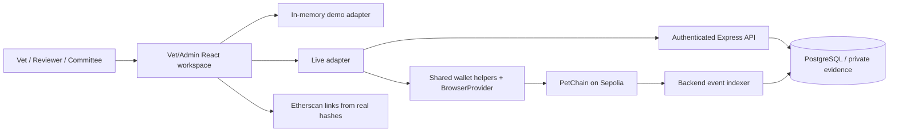

# Architecture — ภาพรวมและขอบเขต rattanapon

เอกสารอธิบายโครงสร้างปัจจุบันและจุดเชื่อม ไม่ใช่หลักฐาน deployment

ปัจจุบัน UI/demo และ live adapter ในขอบเขตนี้มีโค้ดแล้ว ส่วน API เป็น skeleton, indexer และ deployment ต้องรับจากสมาชิกผู้รับผิดชอบ ไม่ได้เพิ่มบริการเหล่านั้นในงานนี้

- `features/vet/VetPanel.jsx`: คิวตรวจ, inspection, no-chip state, ประวัติและ reportFound
- `features/admin/Workspace.jsx`: navigation, wallet/session lifecycle, confirmation, transaction feedback
- `ReviewPanel.jsx`: รับรองเจ้าของ, issueCard, suspension และสถานะเพิกถอน
- `GovernancePanels.jsx`: คัดกรองข้อพิพาท, proposal/voting, role management
- `demo.js`: แยก simulation ที่ต้องเปิดด้วย `?demo=1`; ไม่ใช้ fallback อัตโนมัติ
- `live.js`, `contract.js`, `chain-snapshot.js`: API/ABI boundary และสถานะปัจจุบันจาก Chain
- `transaction.js`, `auth-message.js`: ตรวจ receipt/replacement และข้อความเข้าสู่ระบบ

ข้อมูลส่วนตัวและ notes อยู่ off-chain เท่านั้น Contract รับ digest และ HMAC token จาก backend มี confirmation ก่อน action, transaction lock กันการกดซ้ำ และตรวจ role/chain/account ก่อน sign/send UI เป็นเพียงชั้นช่วยผู้ใช้; Contract/API ต้องบังคับสิทธิ์เองเสมอ

การเข้าถึงหลักฐานใช้ authenticated endpoint และ blob preview ภายในหน้าจอ ไม่มีเอกสารจริงใน repository การเปลี่ยน Wallet ล้างข้อมูลในหน้าจอและป้องกันคำตอบจาก session เก่ากลับมาแสดง

ดูข้อตกลง API และขั้นตอนรวมงานที่ [vet-admin-integration.md](vet-admin-integration.md)
